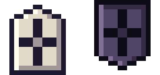
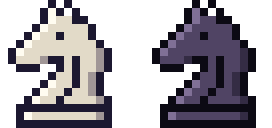

# 0.3.0-beta.10 · Piezas de otros juegos y el Almanaque

*2026-11-04* · **[Descargar](https://github.com/moisesPAello/axedrez-versiones/releases/tag/v0.3.0-beta.10)**

Llegan piezas del xiangqi, el shogi, el janggi, Tamerlán y el ajedrez de Capablanca, y la cebra del ajedrez de fantasía. Y para no perderse entre tanta pieza, el **Almanaque**: una ficha de cada pieza y cada carta, con una animación de cómo se mueve.

## Piezas nuevas

|  |  |  |
|:-:|:-:|:-:|
| Caballo del xiangqi | Torre del shogi | Cañón del janggi |
|  |  |  |
| Jirafa | Arzobispo | Cebra |

- **Caballo del xiangqi:** salta como el caballo, pero cojea: si la casilla recta de al lado está ocupada, no puede saltar por ese lado.
- **Torre y alfil del shogi:** se mueven como la torre y el alfil. Al llegar al fondo se convierten en dragón y caballo dragón.
- **Cañón del janggi:** en línea recta, se mueve y captura solo saltando exactamente una pieza.
- **Jirafa:** un paso en diagonal y luego al menos tres casillas en línea recta, hacia afuera.
- **Arzobispo y canciller:** alfil y caballo a la vez; torre y caballo a la vez.
- **Cebra:** salta 3 casillas en una dirección y 2 en la otra, por encima de lo que haya. Su carta cambia una pieza menor por la cebra y un peón.
- Además: elefante y soldado del xiangqi, elefante y soldado del janggi, y príncipe y espía de Tamerlán. Los peones del makruk y del shatranj ya están en el Almanaque, pero llegan más adelante.

Llegan a tu ejército por cartas de conversión en la tienda.

## Mejoras nuevas

- **Paso de soldado, Mirada del general, Disparo de cañón, Zona de promoción** y los saltos de elefante y de máquina de guerra.
- **Casilla de río:** se pisa, pero no se atraviesa.
- Dos rivales nuevos: el *Señor del río* y el *Timúrida*.

## El Almanaque

Desde el inicio del juego. Cada pieza dice de qué juego viene, cómo se mueve y cómo se consigue.

- Cada juego muestra su ejército completo. Las piezas que comparte con otro juego llevan su nombre local: en el makruk, el rey es el *khun* y la torre, la *rua*.
- En la tienda y en la partida, el nombre de cada pieza en los textos es un enlace: abre una ficha flotante con su animación, y desde ahí el Almanaque, sin salir de donde estás.
- Las cartas de conversión muestran cómo se mueve la pieza que recibes.

## Otros cambios

- En dificultad **Aprendiz** puedes deshacer tus jugadas cuantas veces quieras mientras la partida sigue.

**Para jugar:** descarga el `.apk` en Android, o el `.zip` de Windows o Linux, en *Assets* al final de la release. Los «Source code» que agrega GitHub son las notas de este repo, no el juego. Windows avisa que no está firmado: toca «Más información» y después «Ejecutar de todos modos».
