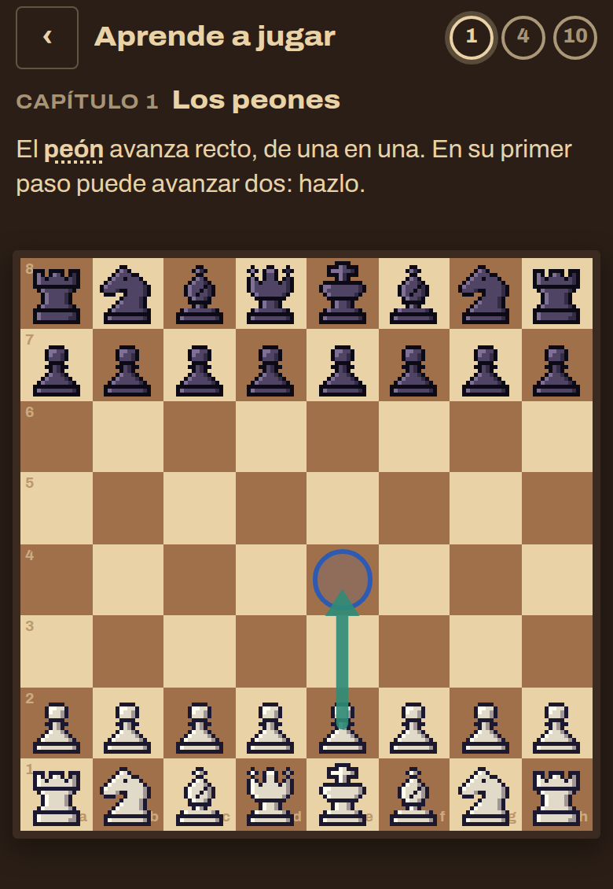
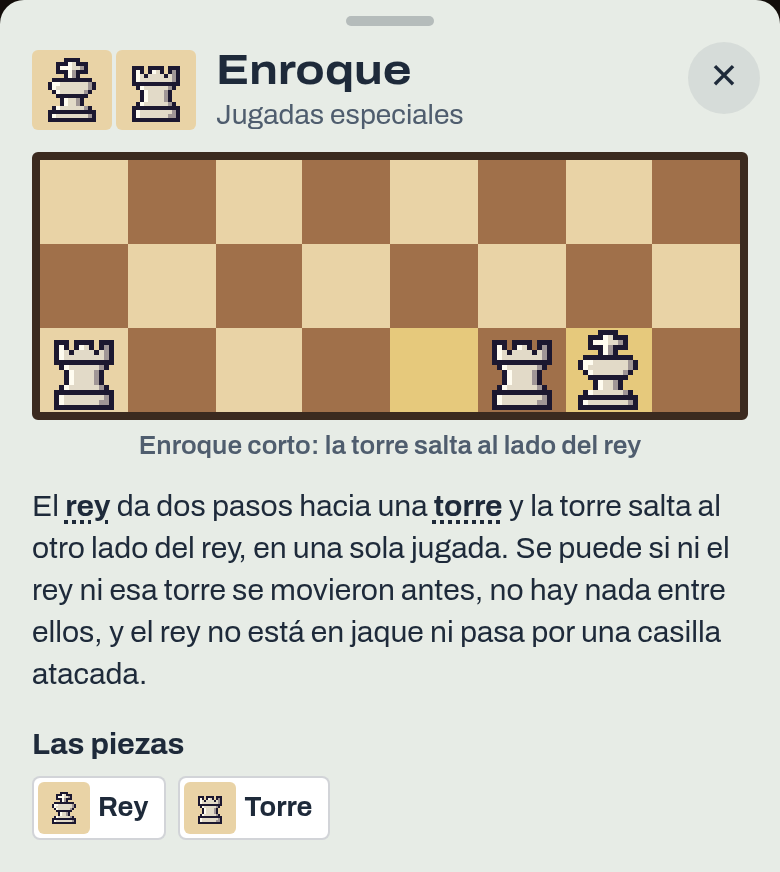
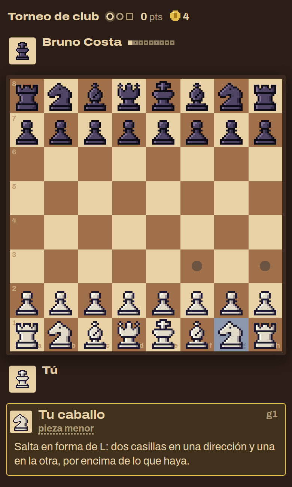
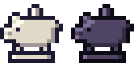
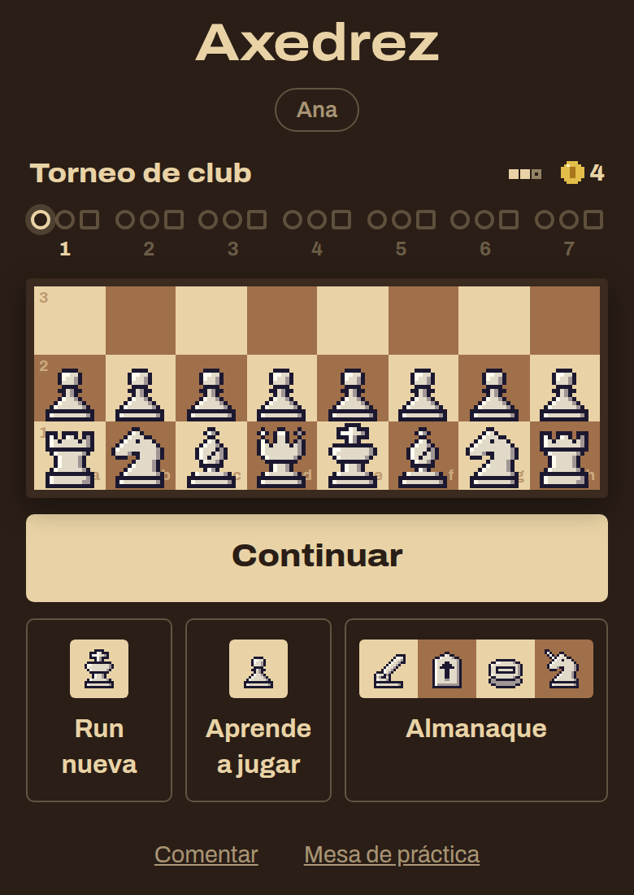
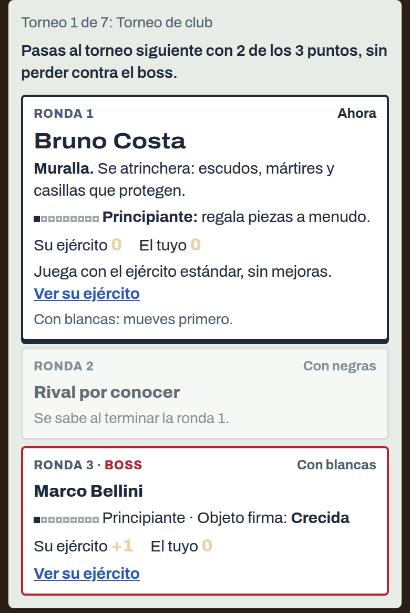

# 0.3.0-beta.13 · Axedrez: aprende a jugar

*2026-11-05* · **[Descargar](https://github.com/moisesPAello/axedrez-versiones/releases/tag/v0.3.0-beta.13)**

Esta versión es para quien nunca jugó ajedrez: un tutorial que te enseña a mover las piezas, las reglas especiales en el Almanaque y cada pieza explicada al tocarla. Además trae el **Cochinito**, un inicio armado alrededor de tu run, un resumen al terminar cada run y rivales que llegan con un número a la vista.

## Aprende a jugar

- **Aprende a jugar**, en el inicio: una partida contra tu entrenador, por capítulos. Por ahora están los peones, el enroque y lo propio de Axedrez (las mejoras y las piezas de otros juegos); los demás capítulos llegan más adelante.
- No se puede perder: solo cuenta la jugada que pide cada paso. Si haces otra, la pieza vuelve y una flecha te muestra la buena. Si te atoras, está el botón **Pista**.

## Reglas en el Almanaque

- Pestaña nueva, **Reglas**, cada una con su animación: **Enroque**, **Captura al paso**, **Coronación** y **El río** del xiangqi.
- La ficha de cada pieza lleva a sus reglas: el peón, a la captura al paso y a la coronación; el rey y la torre, al enroque.

## Las piezas del ajedrez, explicadas

- Al tocar una pieza en la partida (o pasar el mouse por encima), su ficha dice cómo se mueve, también el rey, la dama, la torre, el alfil, el caballo y el peón.
- Sus nombres se pueden tocar en cualquier texto, como los de las demás piezas: "caballo" abre una ventanita con cómo se mueve.
- **Explicar las piezas**, en el menú: si ya te las sabes todas, apágalo y la ficha deja de recordarte cómo se mueven. Las mejoras y las casillas se siguen viendo.

## El Cochinito

|  |
|:-:|
| Cochinito |

- **Cochinito**, en la tienda (común, 3 monedas): una pieza propia de Axedrez que da un paso en línea recta. Cada partida que termina en el tablero ahorra 2 monedas, que cobras al venderlo.
- Si te lo comen, pierde lo ahorrado, pero sigue en tu ejército. Los rivales lo persiguen, y el Materialista más que nadie.

## Tu run, de un vistazo

- **El inicio** gira alrededor de tu run: el camino por los 7 torneos con la próxima partida marcada, tu ejército en un tablero chico y **Continuar** como botón principal. Tus otras runs salen debajo, cada una con su camino.
- **Al terminar una run**, un resumen: hasta dónde llegaste, los puntos, las piezas que comiste, las monedas, lo que compraste y vendiste, y tu ejército al final.
- **Tus mejores marcas**, en el inicio: la run que llegó más lejos, las piezas comidas en una run y tu partida más larga.

## Rivales

- Cada rival llega con **un número**: cuántos peones le lleva su ejército a uno estándar. Sube de ronda en ronda y de torneo en torneo, y en la tarjeta ves el suyo junto al tuyo. En Aprendiz es la mitad.
- Desde el torneo 5, el **Samurái**, el **Señor del río** y el **Timúrida** llegan como boss con el tablero completo de su juego.
- **Ver su ejército** y **Tus mejoras** se agrupan por mejora cuando hay muchas piezas mejoradas.

## Mejoras

- Las mejoras ahora van por clase de pieza ("cualquier pieza menos el rey", "pieza menor"…), así que las piezas de otros juegos también pueden recibirlas. En el Almanaque, la ficha de cada clase dice qué mejoras puede llevar.

## Arreglos

- A veces una jugada se guardaba dos veces y el rival dejaba de contestar a mitad de la partida. Ya no pasa.
- Si una Bomba vecina se lleva a tu campeón, ahora sí cuenta como perdido.
- En la computadora, el tablero del inicio ya no crece hasta salirse de la ventana.

**Para jugar:** descarga el `.apk` en Android, o el `.zip` de Windows o Linux, en *Assets* al final de la release. Los «Source code» que agrega GitHub son las notas de este repo, no el juego. Windows avisa que no está firmado: toca «Más información» y después «Ejecutar de todos modos».
