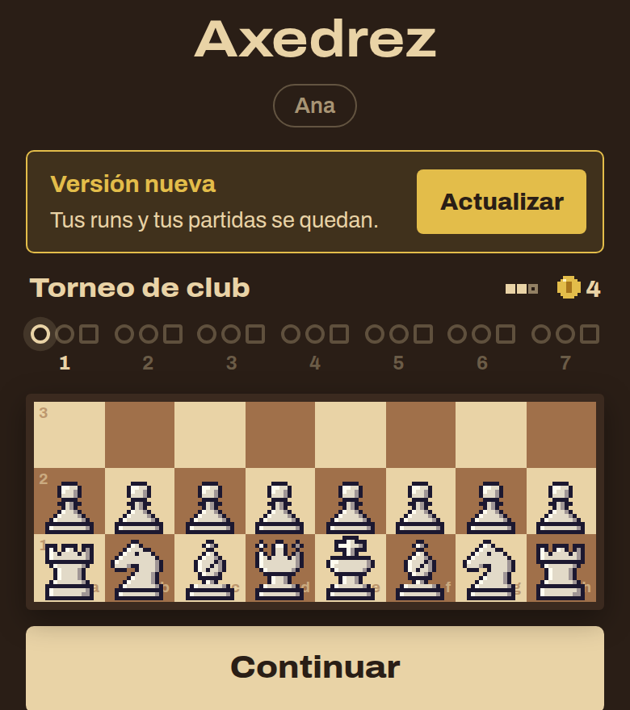
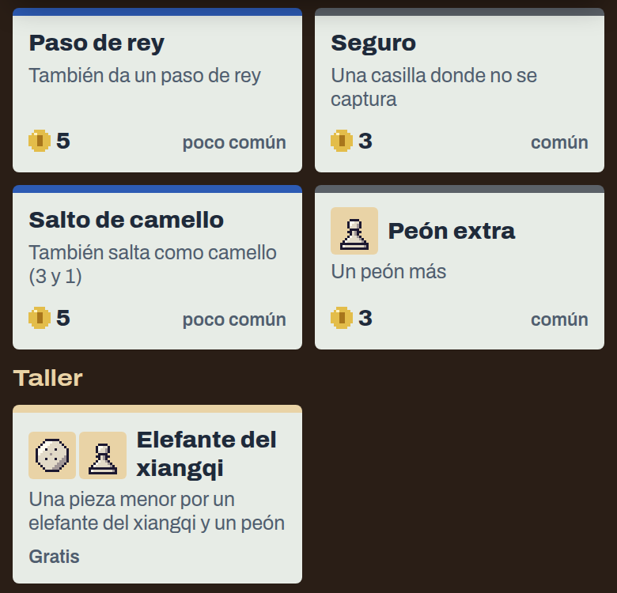
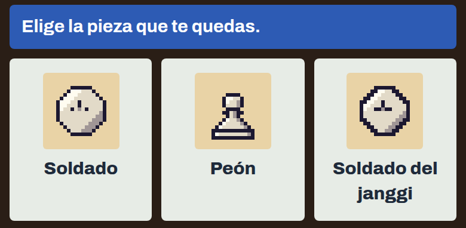
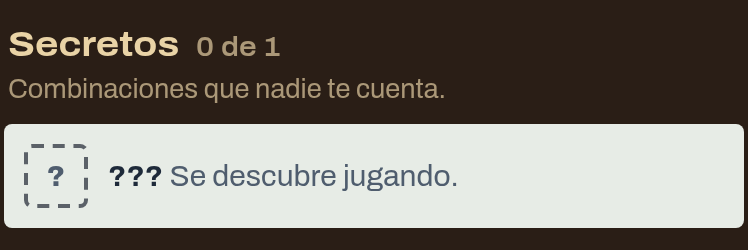

# 0.3.0-beta.14 · Axedrez: se actualiza solo

*2026-11-10* · **[Descargar](https://github.com/moisesPAello/axedrez-versiones/releases/tag/v0.3.0-beta.14)**

Desde esta versión, el juego te avisa cuando sale una nueva y se actualiza con un toque: ya no hace falta bajarla de Discord. Esta la instalas a mano una última vez. Además trae el **Taller**, los **sobres** de piezas, los **secretos** del Almanaque y un campeón que no se pierde en los cambios.

## Se actualiza solo

- Al abrir, si hay una versión nueva, el inicio te la ofrece con **Actualizar**. Tus runs y tus partidas se quedan.
- **En la computadora**, el juego se baja, se reinicia y vuelve solo.
- **En el teléfono**, Android te pide confirmar con un toque; la primera vez, también que permitas a Axedrez instalar apps. Al terminar, el juego se cierra: ábrelo otra vez.
- Esta versión todavía se instala a mano, como siempre. Las siguientes ya te salen en el juego.

## El Taller

- En la tienda, debajo de las ofertas, una fila nueva: **Taller**, gratis. Ahí van los cambios de una pieza por otra de su misma clase, o de una pieza menor por una ligera y un peón. Uno por tienda, y cambia al refrescar.
- Cuando cambias una pieza por otra, la nueva se queda con sus mejoras, las que puede llevar. Si alguna no le sirve, te lo dice al comprar.
- El **Cochinito** ahora sale del Taller, a cambio de una pieza ligera, y ya no se compra suelto.

## Sobres

- **Sobre de peones**, **Sobre de piezas ligeras** y **Sobre de piezas menores**: abres tres piezas al azar de esa clase, del ajedrez o de otros juegos, y te quedas con una.
- El peón va a una casilla vacía de tu fila 2 y las demás a tu fila 1, así que hace falta lugar: vende o cambia una pieza antes.

El Taller, los sobres y el Cochinito nuevo salen en las runs que empieces con esta versión.

## Tu campeón y la coronación

- Si entregas a tu campeón solo en un cambio, la pieza nueva sigue siendo tu campeón. Uno de otro juego sube como su clase: peones y piezas ligeras a caballo, piezas menores a alfil y mayores a dama, y de ahí como siempre.
- Un peón que corona se queda con sus mejoras, como ya pasaba con las piezas de otros juegos.

## Secretos

- En el Almanaque, en **Mejoras**, una sección nueva: **Secretos**. Cada combinación escondida sale como ??? hasta que la descubres jugando, en cualquiera de tus runs.

## Arreglos

- Si nos mandas tus partidas: después de vender una pieza, la run dejaba de mandarlas. Ya no pasa.

**Para jugar:** descarga el `.apk` en Android, o el `.zip` de Windows o Linux, en *Assets* al final de la release. Los «Source code» que agrega GitHub son las notas de este repo, no el juego. Windows avisa que no está firmado: toca «Más información» y después «Ejecutar de todos modos».
