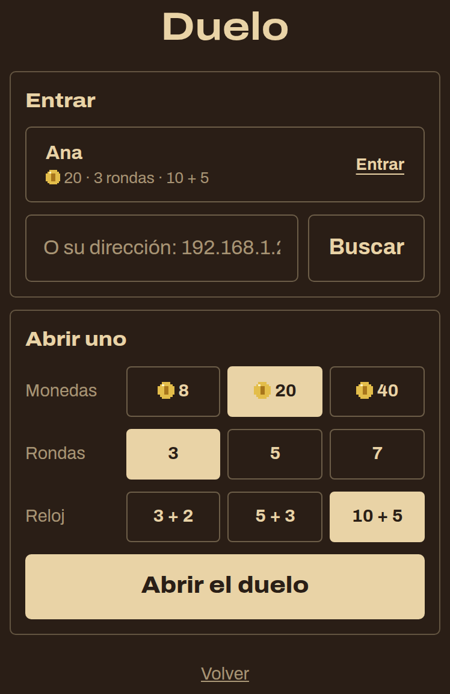
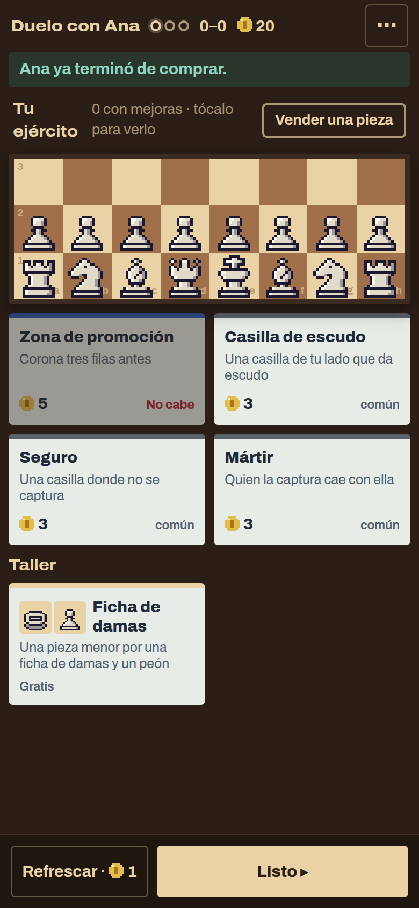
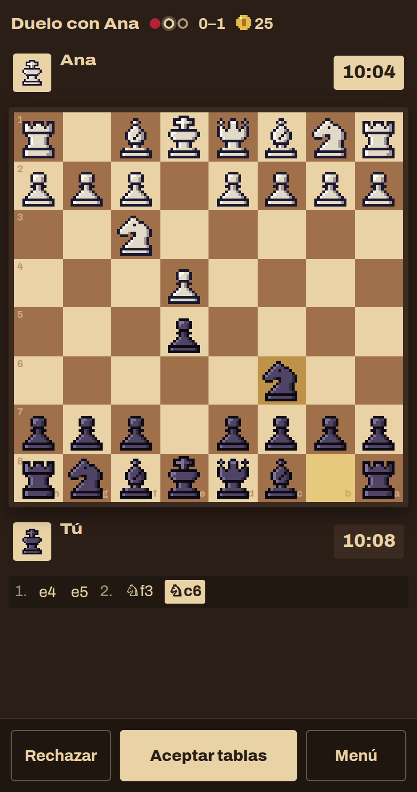
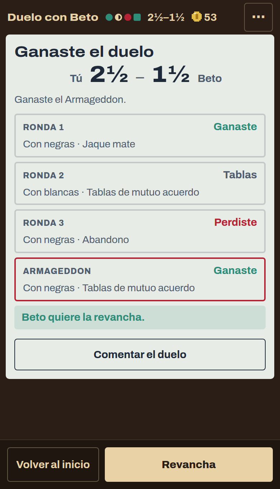

# 0.3.0-beta.15 · Axedrez: el Duelo

*2026-11-10* · **[Descargar](https://github.com/moisesPAello/axedrez-versiones/releases/tag/v0.3.0-beta.15)**

Ahora puedes jugar contra un amigo. El **Duelo** es una run corta entre dos, cada uno en su teléfono o su computadora y en la misma Wi-Fi: antes de cada ronda compran en la misma tienda, después juegan entre ellos, y gana quien suma más. Los dos necesitan esta versión.

## Duelo

- En el inicio, **Duelo**, junto a la run. Uno lo abre y elige con cuántas monedas empiezan (8, 20 o 40), cuántas rondas (3, 5 o 7) y el reloj (3 + 2, 5 + 3 o 10 + 5).
- Al otro le sale en su lista. Si no le sale, que escriba la dirección que le aparece a quien lo abrió.

- Antes de cada ronda, la tienda de la run, con las mismas ofertas para los dos. Lo que compra el otro no se ve hasta sentarse a jugar: solo te avisa cuando terminó.

- Cada ronda es una partida entre los dos y paga como en la run, con el interés por ahorrar. Los colores se turnan.
- Entre dos personas se pueden ofrecer tablas. Si el otro se desconecta, lo ves en su ficha; si no vuelve en 5 minutos, puedes reclamar el duelo.

- Gana quien suma más. Si quedan empatados, un **Armageddon** enseguida, con el mismo ejército: negras juegan con menos tiempo, pero les bastan las tablas.
- Al final, **Revancha** para jugar otro entre los mismos dos. El duelo no toca tus runs.

## En Windows

- La primera vez que abras un duelo, Windows pregunta si Axedrez puede usar la red. Marca "Redes privadas" y toca "Permitir acceso"; si no, el otro no te encuentra.

## Reglas

- Si se te acaba el tiempo y al rival solo le queda el rey, sin mejoras, son tablas: ya no te podía dar mate. Lo mismo al revés.

**Para jugar:** descarga el `.apk` en Android, o el `.zip` de Windows o Linux, en *Assets* al final de la release. Los «Source code» que agrega GitHub son las notas de este repo, no el juego. Windows avisa que no está firmado: toca «Más información» y después «Ejecutar de todos modos».
