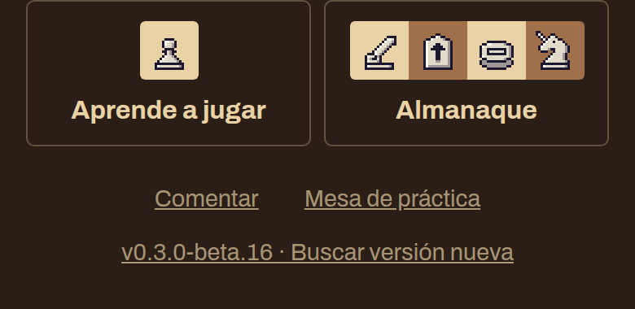
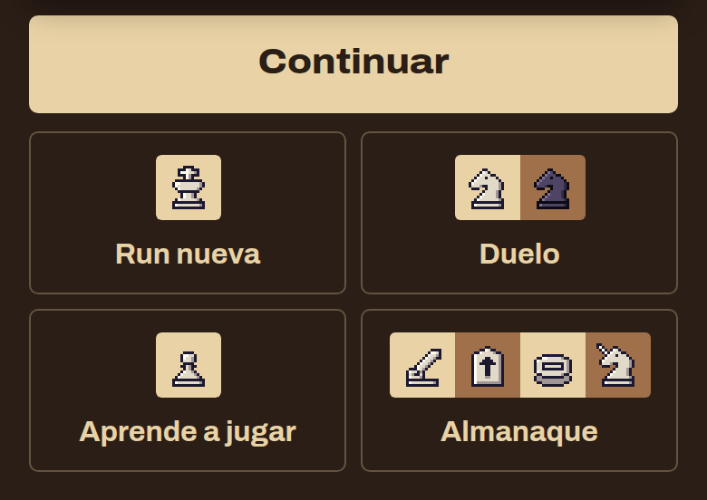

# 0.3.0-beta.16 · Axedrez: busca una versión nueva cuando quieras

*2026-11-10* · **[Descargar](https://github.com/moisesPAello/axedrez-versiones/releases/tag/v0.3.0-beta.16)**

Una versión corta con dos arreglos del inicio. Ahora ves qué versión tienes y puedes buscar una nueva cuando quieras, y las opciones del inicio ya no se salen de la pantalla del teléfono.

## Versión nueva

- Al pie del inicio está la versión que tienes. Tócala para buscar una nueva: te dice **Al día**, **Sin conexión** o, si hay una, te lleva a **Actualizar**.
- El juego también vuelve a buscar cuando regresas a él, no solo al abrirlo.

## Inicio

- Las opciones del inicio van de a dos por fila. Desde que llegó el **Duelo** no cabían en una, y el **Almanaque** se salía por la derecha.

**Para jugar:** descarga el `.apk` en Android, o el `.zip` de Windows o Linux, en *Assets* al final de la release. Los «Source code» que agrega GitHub son las notas de este repo, no el juego. Windows avisa que no está firmado: toca «Más información» y después «Ejecutar de todos modos».
