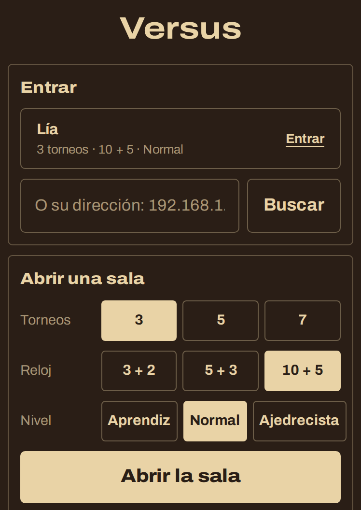
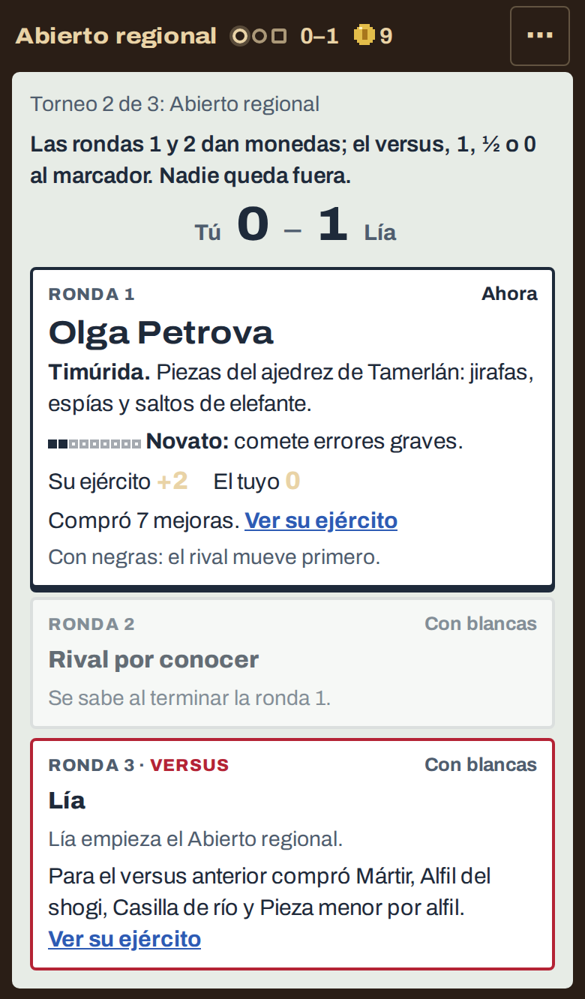
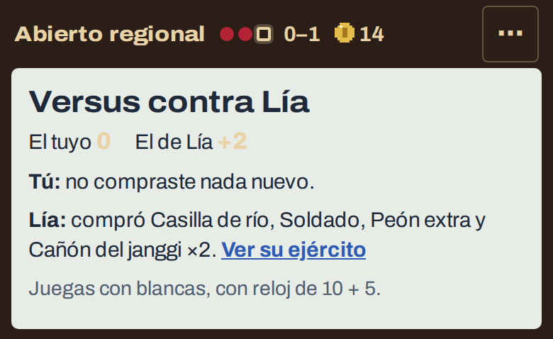
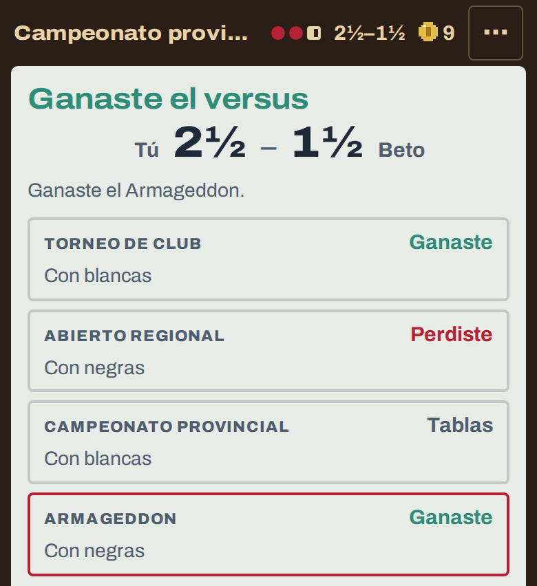

# 0.3.0-beta.17 · Axedrez: el Versus

*2026-11-11* · **[Descargar](https://github.com/moisesPAello/axedrez-versiones/releases/tag/v0.3.0-beta.17)**

Ahora tu run puede ser contra un amigo. En el **Versus** cada uno juega su propia run, en su teléfono o su computadora y en la misma Wi-Fi. Las rondas 1 y 2 de cada torneo son contra la máquina, cada quien a su ritmo, y en la ronda 3, en vez del boss, juegan entre ustedes con el ejército que armó cada uno. Así se ve quién armó mejor su run. Los dos necesitan esta versión.

## Versus

- En el inicio, **Versus**, junto al Duelo. Uno abre la sala y elige cuántos torneos (3, 5 o 7), el reloj (3 + 2, 5 + 3 o 10 + 5) y el nivel de los rivales, el mismo para los dos.
- Al otro le sale en su lista. Si no le sale, que escriba la dirección que le aparece a quien la abrió. Mientras nadie entra, quien abrió ya puede jugar sus rondas.

- Los dos juegan contra los mismos rivales y ven las mismas ofertas en la tienda: lo que separa a las dos runs es lo que decide cada uno.
- En el torneo, la ronda 3 dice contra quién juegas, por dónde va y qué compró para el versus anterior.

- Quien llega primero a la ronda 3 espera con su ejército listo: ya no se puede cambiar. Cuando llegan los dos, ven el número de cada ejército y lo que compró cada uno, y empiezan.

- El versus paga como cualquier partida y da 1, ½ o 0 al marcador. Nadie queda fuera de la run por perder: después del último torneo gana quien suma más. Si quedan empatados, un **Armageddon** enseguida, con los mismos ejércitos.
- Como en el Duelo, se pueden ofrecer tablas, y si el otro se desconecta y no vuelve en 5 minutos, puedes reclamar el versus. Abandonar la run es perder el versus.

## Arreglos

- En el Duelo, si el otro se iba justo antes de empezar la ronda, a veces se cobraba una partida que no se jugó.
- Las partidas contra otra persona que se mandan para ajustar el juego ya no llevan su nombre.

**Para jugar:** descarga el `.apk` en Android, o el `.zip` de Windows o Linux, en *Assets* al final de la release. Los «Source code» que agrega GitHub son las notas de este repo, no el juego. Windows avisa que no está firmado: toca «Más información» y después «Ejecutar de todos modos».
