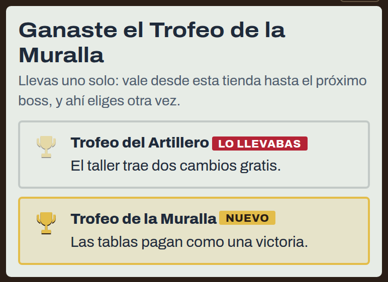
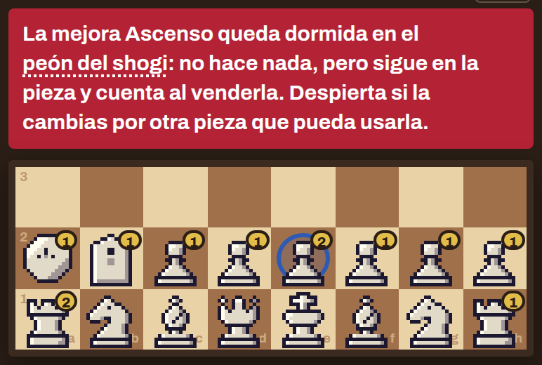
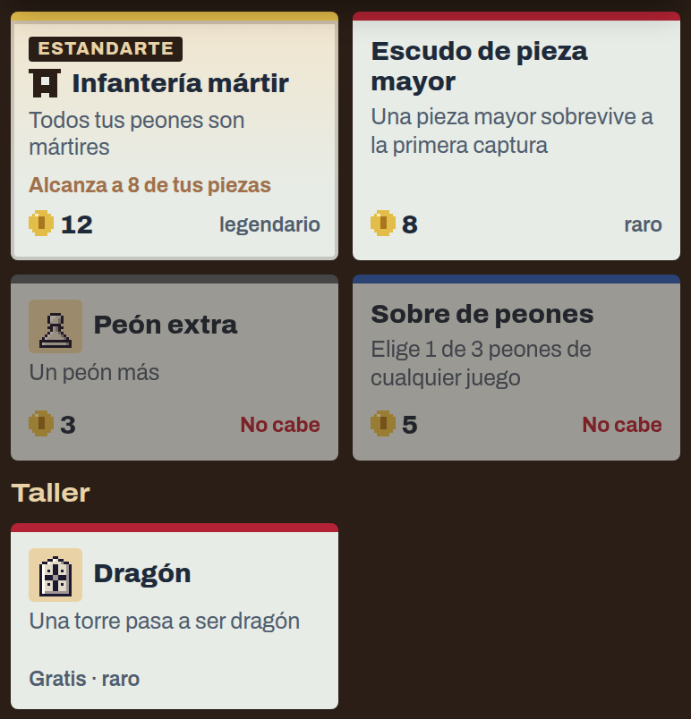
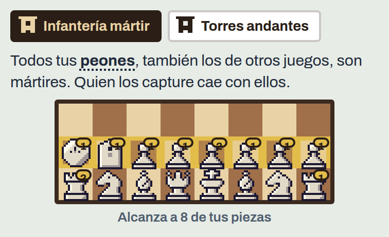

# 0.3.0-beta.18 · Trofeos y la tienda renovada

*2026-11-12* · **[Descargar](https://github.com/moisesPAello/axedrez-versiones/releases/tag/v0.3.0-beta.18)**

Ganarle a un boss ahora deja un **trofeo**, una ventaja que llevas hasta el siguiente. La tienda también cambia: el taller trae a veces cambios raros y legendarios, una pieza ya no pierde sus mejoras al cambiarla, el Escudo viene según la clase de la pieza y los comodines pasan a llamarse **estandartes**. Además cambia dónde entran las piezas nuevas de tu ejército. Las runs empezadas antes siguen sin trofeos y con su tienda de siempre: para verlo todo, empieza una nueva.

## Trofeos

Cada boss muestra desde la ronda 1 el trofeo que deja si le ganas, uno por estilo:

- **Atacante:** el primer refresco de cada tienda es gratis.
- **Muralla:** las tablas pagan como una victoria.
- **Materialista:** cada tienda trae una oferta más.
- **Samurái:** vender una pieza da el doble.
- **Artillero:** el taller trae dos cambios gratis.
- **Hechicero:** una de las ofertas de cada tienda es siempre rara o legendaria.
- **Señor del río:** las casillas (escudo, muro, seguro y río) cuestan la mitad.
- **Timúrida:** los sobres traen cinco piezas para elegir en vez de tres.

Puedes juntar varios, pero solo uno vale a la vez: al pasar cada torneo eliges cuál llevas hasta el próximo boss. Si pasas con tablas contra el boss no ganas el suyo, pero igual eliges entre los que ya tienes. Los bosses de una run no repiten estilo, así que cada uno deja un trofeo nuevo. En el Versus, después de cada versus los dos reciben el mismo trofeo, gane quien gane.

## La tienda

- **Taller con rarezas:** sigue siendo gratis, y ahora a veces sale un cambio raro (una torre por un **Dragón** o una **Torre del shogi**, un alfil por un **Caballo dragón**) y muy de vez en cuando uno legendario: la dama por un **arzobispo** o por un **canciller**. **Dos piezas menores por una torre** también pasa al taller.
- **Las mejoras ya no se pierden en un cambio:** la pieza nueva se queda con todas las de lo que entregas. Si alguna no le sirve, queda dormida: no hace nada, pero cuenta al venderla y despierta si la vuelves a cambiar. La tienda te avisa antes de confirmar. Tu campeón también pasa siempre a la pieza nueva.

- **Cuatro escudos:** el Escudo ahora viene por clase de pieza: **Escudo de peón** (común), **Escudo de pieza ligera o menor** (poco común), **Escudo de pieza mayor** (raro) y **Escudo de pieza superior** (legendario). Con uno solo, siempre convenía ponérselo a la dama.
- **Rarezas nuevas:** **Mártir** y **Casilla de escudo** pasan a poco comunes, **Salto de camello** y **Cebra** a raros, y el **Muro** a común.

## Tu ejército

- **Piezas a la fila 1 y peones a la fila 2.** Todo lo que entra a tu ejército (piezas extra, cambios y sobres) va ahí; a la fila 3 ya no, porque desde ahí una pieza controla el centro sin haber movido. Así tu ejército no pasa de 16 piezas, salvo con **Caballo extra** y **Alfil extra**, que sí entran en tu fila 3. **Ejército sin peones** pone la torre y el alfil en tus filas 1 y 2.
- Lo que no cabe se ve igual en la tienda, con **No cabe** y cómo hacerle sitio: en la misma visita puedes vender una pieza.
- Las piezas que ya tenías en la fila 3 se quedan donde están.

## Estandartes

- Los comodines ahora se llaman **estandartes**: reglas para toda una clase de piezas. Su carta en la tienda dice a cuántas de tus piezas alcanzaría, y al abrirla se iluminan sobre tu ejército.
- En tus mejoras y en "Ver su ejército" van en su propia fila: toca uno y se iluminan las piezas que alcanza.
- Valen también para las piezas de otros juegos: **Infantería mártir** alcanza a todos tus peones, también a los soldados, y **Torres andantes**, a tus torres, torres del shogi, cañones y lanzas. **Peones ambiciosos** sigue siendo solo para los peones del ajedrez.
- El **peón del shogi** ahora es un peón: va a tu fila 2, se consigue cambiando un peón en el taller, sale en el **Sobre de peones** y los estandartes de peones lo alcanzan.

## Arreglos

- En el teléfono, el teclado ya no tapa la hoja donde escribes un comentario, tampoco en la app.
- Cuando la ficha de damas salta contra un escudo, la partida muestra dónde se detiene y qué escudo rompió. Si la cadena se corta en la última fila, la jugada anotada también dice que coronó.

**Para jugar:** descarga el `.apk` en Android, o el `.zip` de Windows o Linux, en *Assets* al final de la release. Los «Source code» que agrega GitHub son las notas de este repo, no el juego. Windows avisa que no está firmado: toca «Más información» y después «Ejecutar de todos modos».
