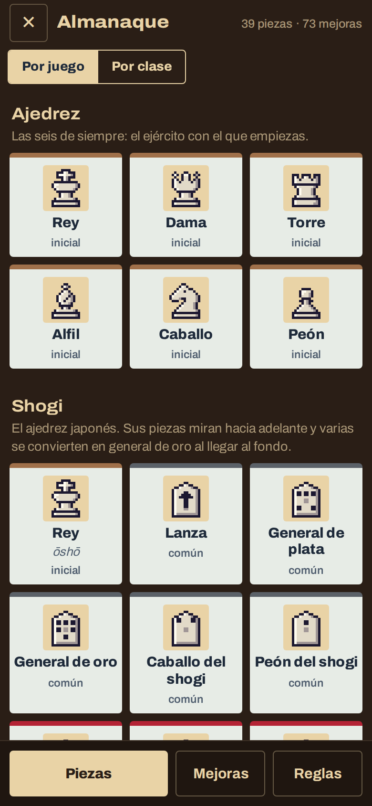
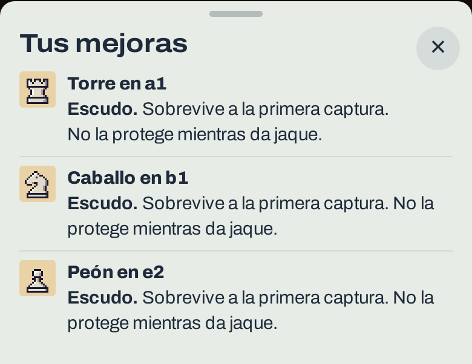

# 0.3.0-beta.19 · Arreglos del almanaque y del escudo

*2026-11-12* · **[Descargar](https://github.com/moisesPAello/axedrez-versiones/releases/tag/v0.3.0-beta.19)**

Una versión corta, con dos arreglos que llegaron por sus comentarios: el almanaque abre rápido también en el teléfono, y una pieza con escudo ya no dice que es de peón.

## Arreglos

- **El almanaque abre más rápido**, sobre todo en el teléfono. Antes esperaba a bajar de internet las letras del juego, y con mala señal tardaba mucho o no aparecía. Ahora las letras vienen dentro del juego, y el almanaque usa las piezas que el juego ya tiene listas en vez de prepararlas otra vez cada vez que lo abres.

- **El escudo se llama Escudo en cualquier pieza.** Desde que hay un escudo por clase de pieza, una torre o un caballo con escudo decían "Escudo de peón". Ahora dicen **Escudo**, sea cual sea el que compraste.

**Para jugar:** descarga el `.apk` en Android, o el `.zip` de Windows o Linux, en *Assets* al final de la release. Los «Source code» que agrega GitHub son las notas de este repo, no el juego. Windows avisa que no está firmado: toca «Más información» y después «Ejecutar de todos modos».
