# 0.3.0-beta.20 · Ranuras y mejoras nuevas

*2026-11-14* · **[Descargar](https://github.com/moisesPAello/axedrez-versiones/releases/tag/v0.3.0-beta.20)**

Cada pieza tiene ahora tres **ranuras**, una por tipo de mejora: movimiento, captura y economía. Con ellas llegan once estandartes nuevos, mejoras que crecen a lo largo de la run, un Ascenso para cada juego, **Rey ágil** y **Antídoto**, y catorce piezas nuevas: cada juego tiene ya sus propias torres, caballos y alferzas. Las runs empezadas antes siguen como estaban: para verlo todo, empieza una nueva.

## Ranuras

- **Una mejora de cada tipo por pieza:** una de movimiento (como **Salto de caballo**), una de captura (como **Escudo** o **Mártir**) y una de economía (como **Botín**). La ficha de cada pieza dibuja sus tres ranuras, llenas, libres o con una mejora dormida.

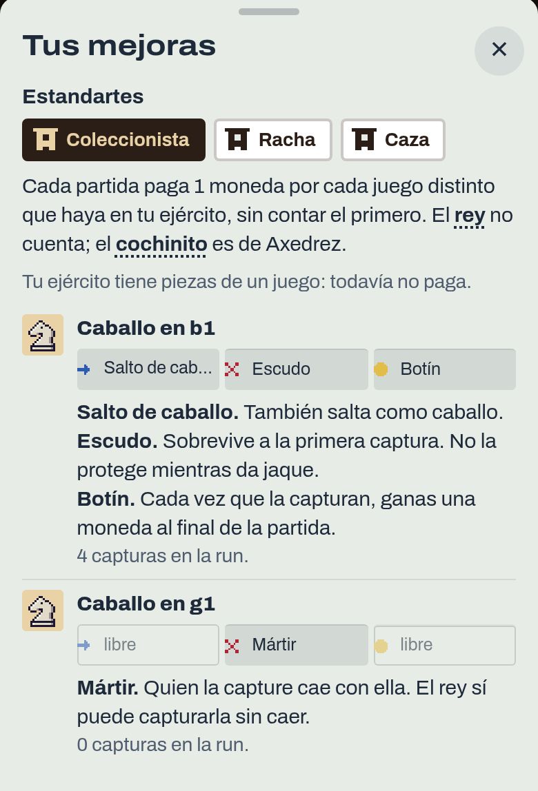

- **Reemplazar:** si compras una mejora de un tipo que la pieza ya tiene, la tienda marca con borde dorado las piezas que la perderían y te pide confirmar antes de cambiarla.

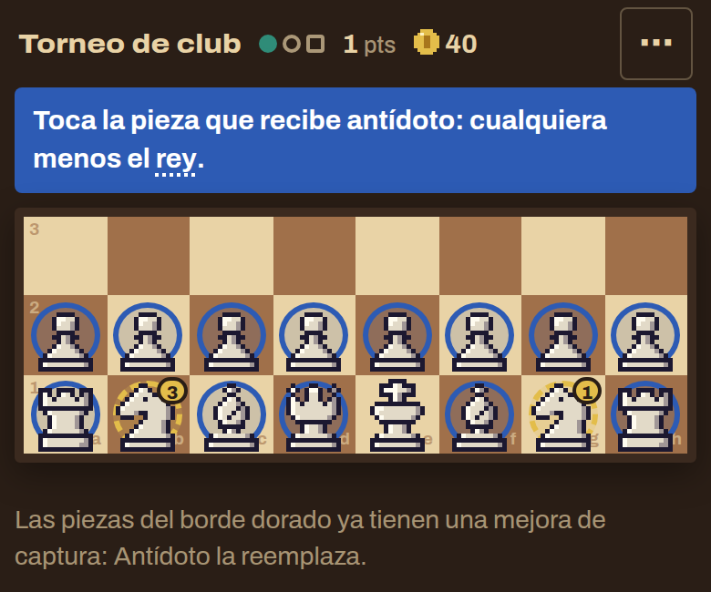

- **En un cambio del taller,** si las piezas que entregas traen dos mejoras del mismo tipo, eliges cuál se queda.
- Lo que da un estandarte, el campeón y lo que roba el **Vampiro** no ocupan ranura.
- Los rivales siguen la misma regla.

## Estandartes

- **Tres a la vez:** con tres estandartes, comprar otro te pide elegir cuál sueltas. El que sueltes puede volver a salir en la tienda.

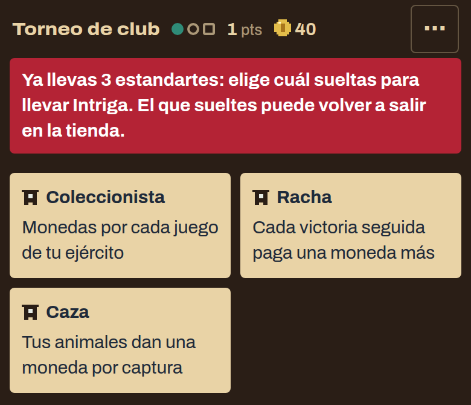

- Los estandartes que dan monedas dicen, en la tienda y en tus mejoras, cómo van: cuántos juegos cuenta el **Coleccionista**, cuántas victorias lleva la **Racha**.
- **Peones ambiciosos** alcanza ahora a todos tus peones, también a los de otros juegos, y cada uno sube por la escalera de su juego.

## Estandartes nuevos

- **Coleccionista:** cada partida paga 1 moneda por cada juego distinto de tu ejército, sin contar el primero.
- **Racha:** cada victoria seguida paga una moneda más, hasta 5 por partida. Unas tablas la mantienen; una derrota la reinicia.
- **Negras:** cada victoria con negras paga 3 monedas más.
- **Prestamista:** el tope del interés sube de 5 a 10 monedas.
- **Caza:** cada captura de tus animales da 1 moneda, como con **Botín**.
- **Leva:** cada peón del ajedrez que corona da 3 monedas.
- **Ceremonia:** cada pieza que corona y no es el peón del ajedrez (las del shogi, los peones del makruk y del shatranj, la ficha de damas) da 1 moneda.
- **Vanguardia:** tus piezas ligeras son mártires.
- **Sol naciente:** tus piezas del shogi que coronan solas lo hacen al entrar en tus filas 6 a 8.
- **Artillería:** tus máquinas también capturan como el cañón del xiangqi, saltando exactamente una pieza.
- **Intriga:** tus piezas de la corte tienen **Vampiro**.

## Mejoras nuevas

- **Rey ágil:** tu rey también salta como caballo, y así sale del encierro de sus propias piezas cuando le dan jaque con un salto. Un rey que saltó ya no puede enrocar. Los rivales de estilo **Muralla** la llevan.
- **Antídoto:** la pieza captura mártires sin caer con ellos, también los que hace un estandarte. No la salva de una bomba.
- **Botín creciente:** cada captura de la pieza da monedas al final de la partida: 1, 2 desde su tercera captura y 3 desde la sexta. Cuenta desde que la compras y no baja aunque te la coman.

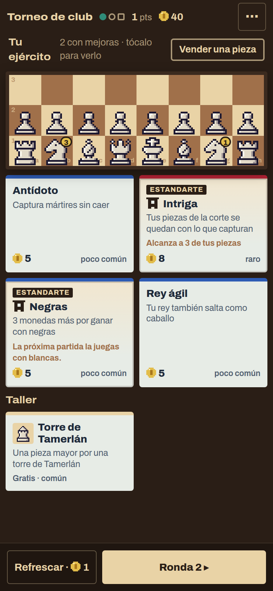

- **Un Ascenso para cada juego:** **Ascenso del ajedrez**, **del shogi**, **del xiangqi**, **del janggi**, **del makruk**, **del shatranj** y **de Tamerlán**. Cada captura sube a la pieza un peldaño de la escalera de su juego, que el Almanaque muestra pieza por pieza. En la tienda cuentan como una sola mejora rara.
- **El campeón** también sube por la escalera de su juego.
- La ficha de cada pieza cuenta sus capturas en toda la run.

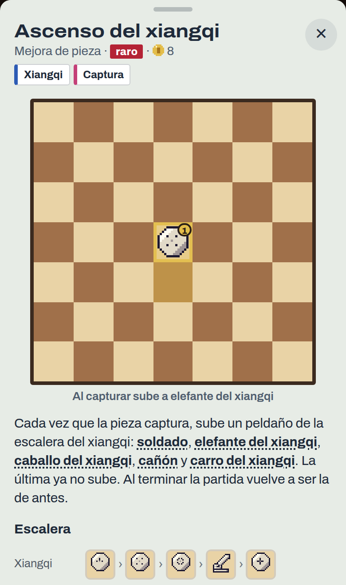

## Piezas propias de cada juego

Donde un juego usaba la torre, el caballo o la alferza de otro, ahora tiene la suya, con su nombre y su dibujo.

| 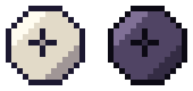 | 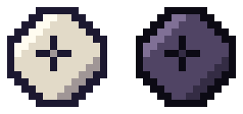 | 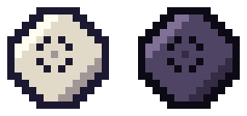 |
|:-:|:-:|:-:|
| Carro del xiangqi | Carro del janggi | Caballo del janggi |
| 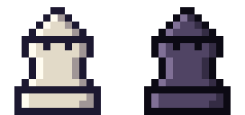 | 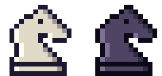 | 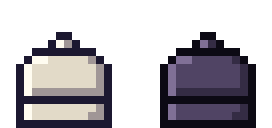 |
| Torre de Tamerlán | Caballo de Tamerlán | Torre del makruk |
| 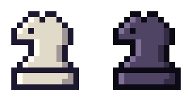 | 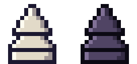 | 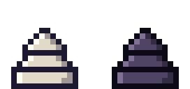 |
| Caballo del makruk | Noble del makruk | Alferza del makruk |
| 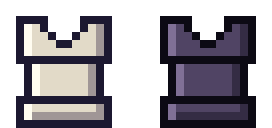 | 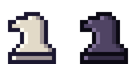 | 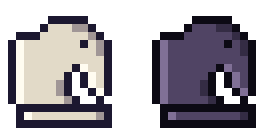 |
| Torre del shatranj | Caballo del shatranj | Elefante del shatranj |
| 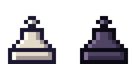 | 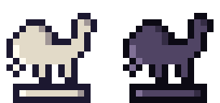 |
| Alferza del shatranj | Camello de fantasía |

- **Se mueven como la pieza que reemplazan:** los carros y las torres, como la torre pero sin enroque; los caballos, como el caballo (el del janggi cojea, igual que el del xiangqi); el **noble del makruk**, como el general de plata, pero no corona.
- Los peones del makruk y del shatranj coronan en la alferza de su juego.
- Llegan por el taller, con un cambio común cada una, y por los sobres de su clase.
- **Nombres originales:** un ajuste nuevo del menú deja leer cada pieza de otro juego con el nombre que tiene en el suyo: rukh, faras, met.

**Para jugar:** descarga el `.apk` en Android, o el `.zip` de Windows o Linux, en *Assets* al final de la release. Los «Source code» que agrega GitHub son las notas de este repo, no el juego. Windows avisa que no está firmado: toca «Más información» y después «Ejecutar de todos modos».
