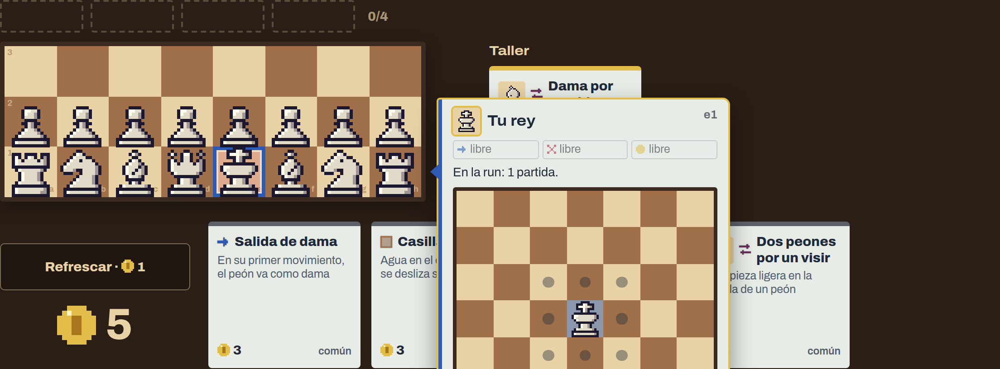
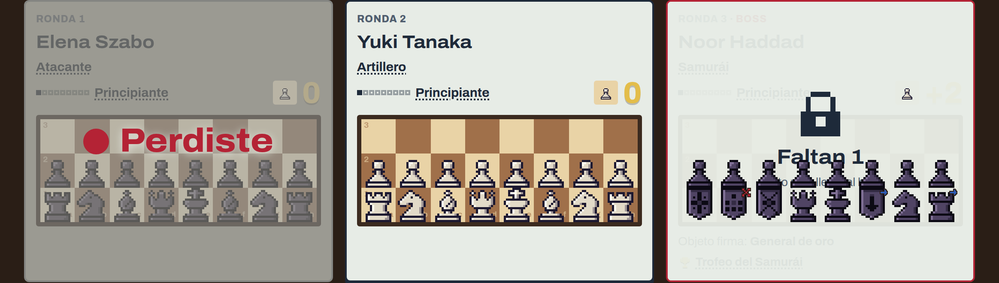
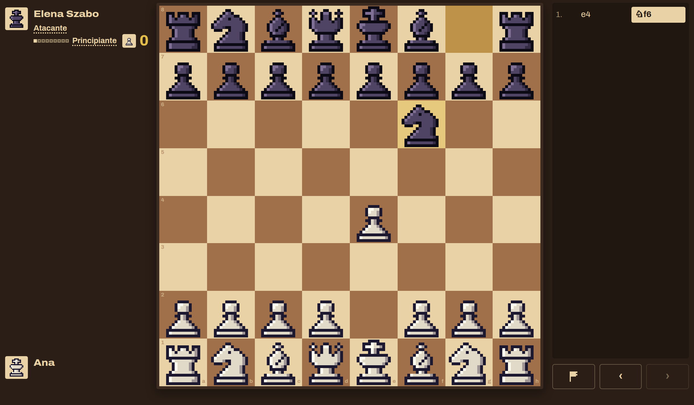
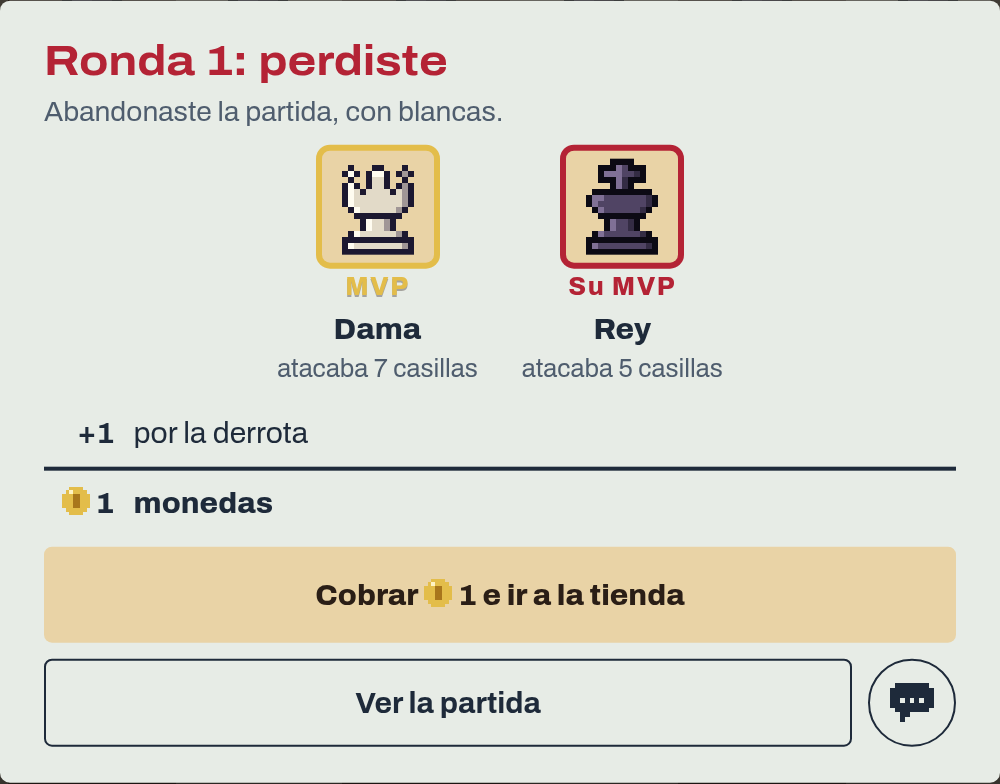
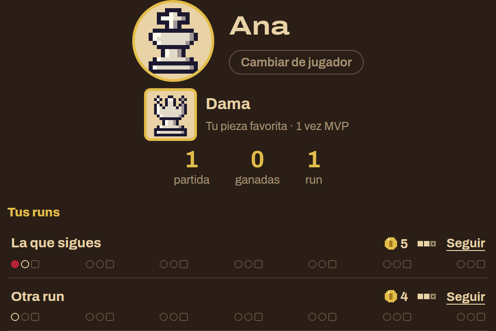

# 0.3.0-beta.21 · Todo nuevo por dentro

*2026-11-19* · **[Descargar](https://github.com/moisesPAello/axedrez-versiones/releases/tag/v0.3.0-beta.21)**

Una versión de pantallas: la tienda se parece a la de Balatro, el torneo muestra sus rondas, cada pieza dice qué mejoras tiene y la partida de escritorio se centra como en chess.com. Llegan seis **mejoras de movimiento** nuevas, cinco **estandartes de regla** de otros juegos, once cambios de **dos peones por una pieza ligera**, la conversión **Damas** y la venta de estandartes. Las runs empezadas antes siguen como estaban: para ver todo, empieza una nueva.

## La tienda

- **Tienda como la de Balatro:** en escritorio, las cartas se abren en abanico, con el taller a un lado y el ejército encima. En el teléfono se ve igual que antes, con más espacio.

- **Fijar una pieza con Ctrl-clic:** la carta de la pieza se queda abierta a un lado y lista sus mejoras primero. Desde la carta se puede vender la pieza sin ir al almacén.
- **Vender estandartes:** un estandarte se vende por la mitad de su precio, como las piezas. Con **Regateo**, por 1 moneda más.
- **Cuatro estandartes a la vez:** antes eran tres. Las runs empezadas con tres se quedan con tres.
- **Categorías con símbolo:** cada tipo de mejora lleva un icono en la tienda y en la carta de la pieza.

## El torneo

- **Tres tarjetas de ronda:** el torneo se ve como tres cartas, cada una con el ejército del rival dibujado. Las rondas jugadas se quedan con su resultado.

- **Tarjeta del rival:** el estilo, el nivel y el trofeo del rival enlazan a ventanas flotantes que explican cada uno.

## La partida

- **Escritorio como chess.com:** el tablero al centro, tu nombre y el del rival arriba y abajo, el contador y los botones a un lado.

- **Las mejoras de cada pieza, en el tablero:** pasando el ratón o manteniendo pulsada una pieza, las dos listas de mejoras (tuyas y del rival) se ven debajo del tablero. Ctrl abre la carta de la pieza con la animación del Almanaque.
- **MVP de la partida:** al terminar una partida, la ventana de resultado dice qué pieza fue la más valiosa: la que atacó más casillas en las jugadas que contaron.

## Página del jugador

- **Tu página:** foto de perfil, pieza favorita, partidas jugadas y victorias. La foto se guarda en el servidor y sale en la tarjeta de tu nombre durante la partida.

## Inicio y ajustes

- **Inicio nuevo:** Continuar, Jugar, Multijugador y Más. Los ajustes están en su propia ventana, agrupados.
- **Cabecera de la run:** la escalera, las monedas y el número de piezas de tu ejército siempre arriba.
- **Números con un peón:** el número de piezas se muestra con un peón al lado.

## Mejoras de movimiento

Seis mejoras nuevas para las piezas de tu ejército. Cada una ocupa la ranura de movimiento.

- **Enroque de escape:** tu rey puede enrocar estando en jaque.
- **Enroque de Babel:** tu pieza mayor enroca, como si fuera la torre, con una pieza que no sea torre. Para el carro del xiangqi, el del janggi y la torre de Tamerlán, entre otras.
- **Paso Berolina:** tu peón avanza en diagonal (sin capturar) y captura recto. Su doble paso en diagonal se captura al paso. Solo sale de la fila 2.
- **Salida de alferza:** la pieza da un primer paso en diagonal, como la alferza, que se pierde en cuanto se mueve.
- **Ladrón:** tu peón captura sin comer: se queda con la mejora de la pieza rival y la deja en pie. Solo funciona con **Botín**.
- **Salida de dama:** tu peón da un primer paso como dama: una casilla en cualquier dirección, que se pierde en cuanto se mueve.

## Estandartes de regla

Cinco estandartes nuevos que cambian las reglas de la partida.

- **Pasar:** en tu turno puedes pasar, sin mover nada, cuantas veces quieras, menos estando en jaque. El rival no puede.
- **Makruk:** tus peones empiezan cada partida en la fila 3, si la casilla de delante está libre.
- **Ciudadela:** si tu rey llega a h1 (o el rival a a8), y no tiene más piezas que peones, son tablas.
- **Ahogado:** si no tienes jugada legal, pierdes, en vez de empatar.
- **Rey despojado:** si capturas la última pieza del rival que no sea su rey, ganas.

## Dos peones por una pieza ligera

Once cambios nuevos del taller: entregas dos peones de cualquier juego y recibes una pieza ligera. Las piezas ligeras ahora también entran en la fila 2, como los peones.

- **Damas:** todos tus peones pasan a fichas de damas. Las fichas se colocan en las filas 2 y 3.

## Estandartes nuevos

- **Salida de caballo:** tus alfiles y tu dama dan un primer paso de caballo, que se pierde en cuanto se mueven.
- **Guardia de casa:** tus piezas mayores llevan un escudo mientras sigan en su casilla de salida. Si ya tienen un **Escudo**, la guardia cae primero.
- **Regateo:** vender una pieza o un estandarte paga 1 moneda más.

## Arreglos

- **El Paso Berolina** solo da su doble paso desde la fila 2, como el peón normal.
- **La jirafa con Disparo de cañón** dispara recto después de girar, como la máquina de guerra.
- **Los estandartes de monedas** llevan el tipo Economía y solo muestran las piezas que realmente alcanzan.
- **El Almanaque** lista los estandartes que llegan a cada pieza.
- **Las descripciones de mejoras** enlazan las piezas que nombran.
- **Las fichas de los estandartes** se fijan en la tienda, como las de las piezas.

**Para jugar:** descarga el `.apk` en Android, o el `.zip` de Windows o Linux, en *Assets* al final de la release. Los «Source code» que agrega GitHub son las notas de este repo, no el juego. Windows avisa que no está firmado: toca «Más información» y después «Ejecutar de todos modos».
