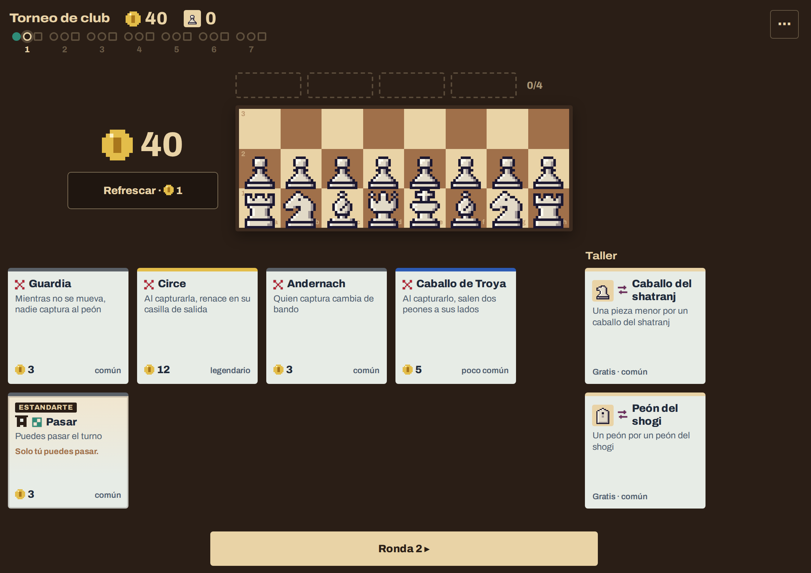
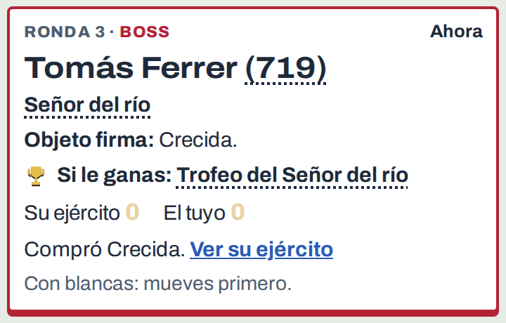
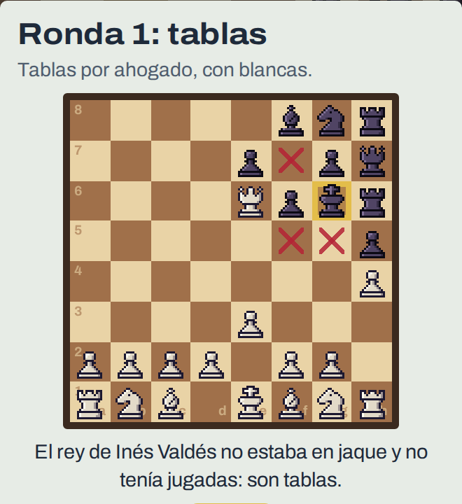

# 0.3.0-beta.22 · Mejoras de captura de las variantes

*2026-11-24* · **[Descargar](https://github.com/moisesPAello/axedrez-versiones/releases/tag/v0.3.0-beta.22)**

Llegan cuatro **mejoras de captura** sacadas de variantes del ajedrez: piezas que renacen, que cambian de bando o que no se dejan comer. Y un pulido de pantallas: la tienda se ordena de otra forma en escritorio, cada rival muestra su Elo, el boss se ve entero y el ahogado se explica con un tablero. Las runs empezadas antes siguen como estaban: para ver las mejoras nuevas, empieza una nueva.

## Mejoras de captura

Cada una ocupa la ranura de captura.

- **Guardia:** mientras tu peón no se haya movido en la partida, nadie lo puede capturar, como en la casilla de seguro del parchís. Si da jaque, sí.
- **Caballo de Troya:** cuando capturan a tu caballo, salen dos peones de tu color a sus lados. Hay uno para el caballo de cada juego con peones (del ajedrez, del shogi, del xiangqi, del janggi, del makruk y del shatranj).
- **Circe:** cuando capturan a la pieza, renace en su casilla de salida, si está libre. Legendaria.
- **Andernach:** en toda captura donde está esta pieza, la que captura cambia de bando. Si la capturan, quien la capturó pasa a ser tuya; si ella captura, pasa a ser del rival. Corta para los dos lados.

## La tienda

- **Nuevo orden en escritorio:** los estandartes y tu ejército arriba, al centro; las monedas y Refrescar a su izquierda; las ofertas debajo, en fila, con el taller a la derecha bajo su propio título.

## El torneo

- **El Elo del rival:** cada rival lleva su Elo junto al nombre, como en chess.com ("Inés Valdés (719)"), en vez de los puntos de nivel. Tocando el número se ve cómo juega.
- **El boss, entero:** la tarjeta del boss enseña su ejército, su objeto firma y su trofeo aunque todavía no lo puedas jugar. Lo que falta para enfrentarlo va en una marca corta ("Falta 1 punto").

## La partida

- **El ahogado, en un tablero:** cuando una partida acaba en ahogado, la ventana de resultado muestra la posición final con el rey rodeado y una cruz en cada casilla a la que no podía ir. Una línea lo explica: no estaba en jaque y no tenía jugadas. Con el estandarte **Ahogado**, la derrota se ve igual.

- **Estandartes que se gastan:** **Guardia de casa** y **Salida de caballo** dejan de valer cuando la pieza se mueve. Su ficha en la partida cuenta cuántas piezas lo llevan todavía ("1/2") y se apaga en 0, para ti y para el rival. Las marcas del tablero también se van cuando el efecto ya no vale.

**Para jugar:** descarga el `.apk` en Android, o el `.zip` de Windows o Linux, en *Assets* al final de la release. Los «Source code» que agrega GitHub son las notas de este repo, no el juego. Windows avisa que no está firmado: toca «Más información» y después «Ejecutar de todos modos».
