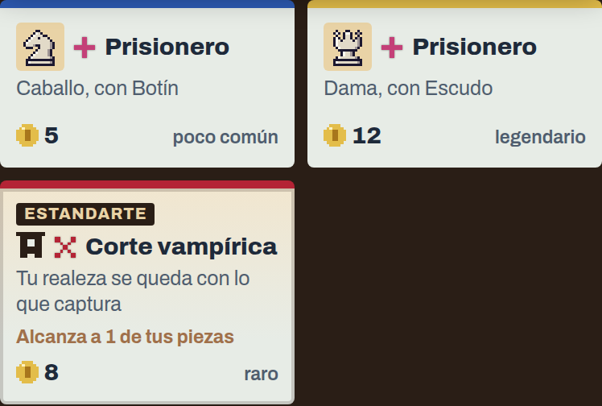
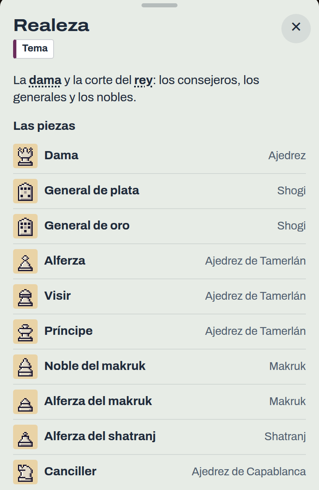

# 0.3.0-beta.23 · Prisioneros y embajada

*2026-11-25* · **[Descargar](https://github.com/moisesPAello/axedrez-versiones/releases/tag/v0.3.0-beta.23)**

La tienda cambia de fondo: ahora puedes quedarte con una pieza que le capturaste al rival, el taller pasa a ser la **embajada** y tiene las piezas de todos los juegos, y los sobres se van. También cambian los temas de las piezas y el nombre de varios estandartes. Las runs empezadas antes ven los nombres nuevos, pero los prisioneros, la embajada y el precio nuevo de Refrescar llegan con una run nueva.

## Prisioneros

- **Prisionero:** te quedas con la mejor pieza que le capturaste al rival en la partida anterior, con sus mejoras y tal como la capturaste (un peón que coronó en dama llega como dama). Gane quien gane. Hay uno por rareza: el común trae un peón; el poco común, hasta una pieza menor; el raro, hasta una mayor, y el legendario, hasta una superior. Si no capturaste ninguna que quepa, la oferta sale igual y lo dice. También vale en el duelo y en el versus.
- **Trofeo del Timúrida:** cada Prisionero enseña hasta tres piezas, las mejores que quepan, y eliges una.

## La embajada

- **El taller ahora es la embajada:** entregas una pieza tuya y una corte de otro juego te da una de las suyas. Están todas las piezas de todos los juegos, también la dama, la ficha coronada y los peones del makruk y del shatranj, y cada carta dice de dónde viene ("Embajada del makruk").
- **Más fácil de usar:** cada cambio acepta cualquier pieza de la clase de la que recibes o más alta, sin el peón que se daba antes de más. Las piezas mayores salen menos (raras) y las superiores muy poco (legendarias).
- **Sin sobres:** las piezas de otros juegos llegan por la embajada y como prisioneros.

## La tienda

- **Refrescar** empieza en 2 monedas en cada tienda y sube 1 cada vez. Con el **Trofeo del Atacante**, empieza en 0.

## Temas y nombres

- **Cinco temas:** las piezas se agrupan ahora en **Realeza**, **Clero**, **Infantería**, **Artillería** y **Caballería**, por lo que representan. Cada pieza del ejército inicial está en uno distinto: la dama en Realeza, el alfil en Clero, el peón en Infantería, la torre en Artillería y el caballo en Caballería.
- **El atalaya:** el espía del ajedrez de Tamerlán pasa a llamarse atalaya.
- **Estandartes con nombre nuevo:** Infantería mártir pasa a **Sacrificio**; Peones ambiciosos, a **Hidalguía**; Torres andantes, a **Asedio**; Guardia de casa, a **Guarnición**; Salida de caballo, a **Justa**, y Artillería, a **Balística**. Intriga pasa a **Corte vampírica** y ahora alcanza solo a la Realeza.

**Para jugar:** descarga el `.apk` en Android, o el `.zip` de Windows o Linux, en *Assets* al final de la release. Los «Source code» que agrega GitHub son las notas de este repo, no el juego. Windows avisa que no está firmado: toca «Más información» y después «Ejecutar de todos modos».
