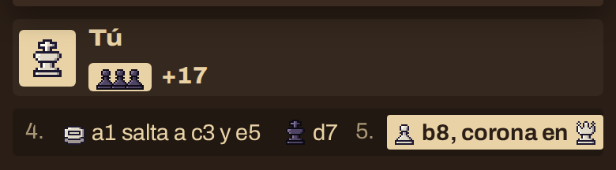
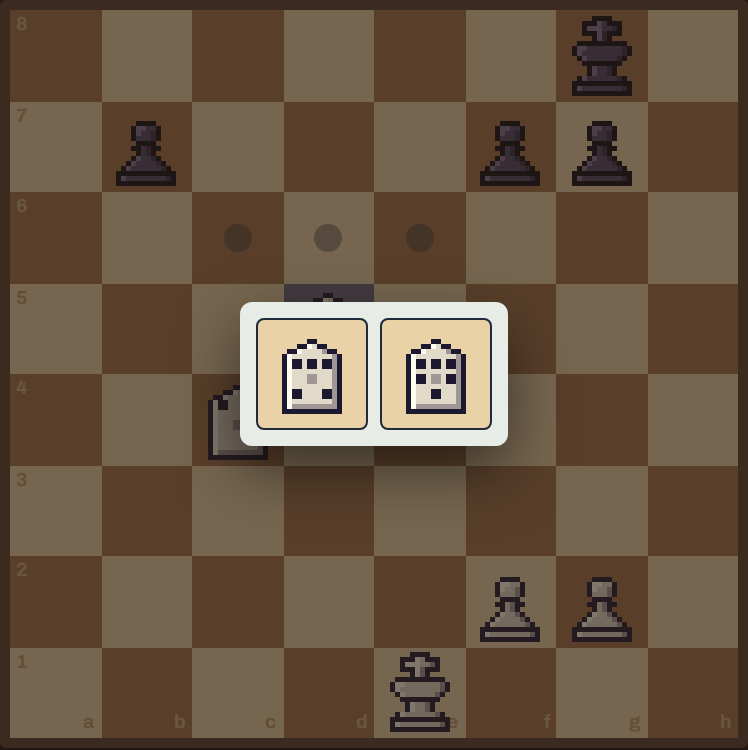

# 0.3.0-beta.24 · La planilla en palabras

*2026-11-27* · **[Descargar](https://github.com/moisesPAello/axedrez-versiones/releases/tag/v0.3.0-beta.24)**

La planilla deja la notación de ajedrez y escribe cada jugada con el dibujo de la pieza y en palabras, para que se lea sin saber notación. Las piezas del shogi coronan ahora como en el shogi: tú eliges. Y el Rey despojado gana la jugada de respuesta que tenía en el shatranj. Tus runs siguen tal como estaban.

## La planilla

- **Cada jugada con su pieza:** junto a cada jugada va el dibujo de la pieza que se mueve, del color de su bando, y el resto en palabras: «come d5», «come al paso d6», «enroque corto», «pasa», «b8, corona en» y la pieza en que corona, «…, jaque» y «…, jaque mate».
- **La ficha de damas** dice por dónde salta: «a1 salta a c3 y e5».
- **Dos piezas iguales:** cuando las dos pueden llegar a la misma casilla, la jugada dice también de dónde sale («g1 f3»).

## Shogi

- **Coronar es opcional:** el general de plata, el caballo, la lanza y el peón del shogi, la torre del shogi y el alfil del shogi pueden coronar al terminar una jugada que entra, se mueve dentro o sale de tus filas 6 a 8. El tablero te pregunta si coronas.
- **Solo es obligatorio** cuando la pieza ya no podría moverse sin coronar: el peón y la lanza en la fila 8, el caballo en las filas 7 y 8.
- **Zona de promoción** y **Sol naciente** salen de la tienda, porque el shogi ya trae esa zona. Si las tienes en una run, siguen en tu ejército.

## Reglas

- **Rey despojado:** si al rey que se queda solo le toca capturar en su jugada la última pieza del rival, y la captura, son tablas, como en el shatranj.
- **Los peones de todos los juegos** cuentan como peones para la regla de las 50 jugadas, y la **Bomba** ya no se los lleva. Tampoco se lleva la pieza que está en un seguro, y a la vecina con escudo solo le quita el escudo.
- **Jugadas anticipadas:** ahora saben cómo se mueve cada pieza de cada juego, también las que cojean o disparan.

**Para jugar:** descarga el `.apk` en Android, o el `.zip` de Windows o Linux, en *Assets* al final de la release. Los «Source code» que agrega GitHub son las notas de este repo, no el juego. Windows avisa que no está firmado: toca «Más información» y después «Ejecutar de todos modos».
